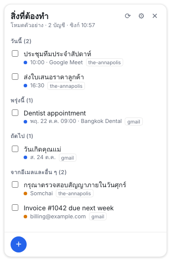

# To-do widget

วิดเจ็ต To-do บนเดสก์ท็อปที่ดึงนัดหมายจาก Google Calendar และอีเมลจาก Gmail มาแสดงเป็นรายการงาน พร้อมเพิ่มงานเองได้

A small always-on-top desktop widget (Electron) that turns Google Calendar events and Gmail messages into a to-do list, alongside tasks you add yourself. Works on Windows, macOS and Linux.



## Features

- งานจาก **ปฏิทิน**: นัดหมายตั้งแต่วันนี้ถึง 7 วันข้างหน้า (ปรับได้) จากปฏิทินที่เลือก
- งานจาก **อีเมล**: อีเมลที่ติดดาว หรือยังไม่อ่านในกล่องจดหมายภายใน 7 วัน (ปรับคำค้น Gmail ได้)
- **เพิ่มงานเอง** พร้อมวันครบกำหนด
- จัดกลุ่ม: เลยกำหนด / วันนี้ / พรุ่งนี้ / ถัดไป / จากอีเมล
- **หลายบัญชี Google**: รวมงานจากทุกบัญชีไว้ในรายการเดียว (ค่าเริ่มต้น: `nakorn@the-annapolis.com` และ `joke.nakorn22@gmail.com`) แต่ละรายการมีป้ายบอกว่ามาจากบัญชีไหน
- ติ๊กเสร็จ, ซ่อนรายการ, เปิดต้นฉบับใน Calendar/Gmail
- ซิงก์อัตโนมัติทุก 10 นาที, แสดงอยู่บนสุดเสมอ (ปิดได้)
- อ่านข้อมูล Google แบบ read-only เท่านั้น ไม่แก้ไขปฏิทินหรืออีเมล

## ติดตั้งบน Windows / Install on Windows

1. ดับเบิลคลิก `To-do Widget Setup 0.1.4.exe` (ถ้า Windows ขึ้นหน้าจอ SmartScreen เพราะตัวติดตั้งยังไม่ได้ลงลายเซ็น ให้กด **More info → Run anyway**)
2. วิดเจ็ตจะเปิดที่มุมขวาบนของจอ และเปิดเองทุกครั้งที่เข้าเครื่อง (ปิดได้ใน ⚙)
3. กด **เลือกไฟล์ credentials.json…** แล้วเลือกไฟล์ที่ดาวน์โหลดจาก Google Cloud (ดูหัวข้อด้านล่าง)
4. กดเข้าสู่ระบบทีละบัญชี

ถอนการติดตั้งได้จาก Settings → Apps → Installed apps → To-do Widget

Build the installer yourself with `npm run dist:win` (on Linux this needs Wine). Output goes to `dist/`.

## Try it without Google (demo mode)

```bash
npm install
npm run demo
```

## Connect your Google account

The app signs in with your own Google Cloud OAuth client, so your data goes straight from Google to your computer.

1. Open [Google Cloud Console](https://console.cloud.google.com/) and create a project.
2. **APIs & Services → Library**: enable **Google Calendar API** and **Gmail API**.
3. **APIs & Services → OAuth consent screen**: choose *External* (so both the Workspace and the Gmail account can sign in), fill in the app name, and add every account you will use under **Test users**.
4. **APIs & Services → Credentials → Create credentials → OAuth client ID**, application type **Desktop app**. Download the JSON.
5. In the widget, click **เลือกไฟล์ credentials.json…** and pick the downloaded file. (When running from source you can also save it as `credentials.json` in this folder.)
6. The widget shows a **เข้าสู่ระบบ …** button for each account in the list; click each one and approve in the browser.

Every signed-in account is synced and merged into one list. Add more accounts with **+ เพิ่มบัญชี** in ⚙ settings, or remove one with **ออก**. If one account fails to sync, its last items stay and the others keep working.

### Settings

| Setting | Default |
| --- | --- |
| Accounts | `nakorn@the-annapolis.com`, `joke.nakorn22@gmail.com` |
| Gmail query | `in:inbox (is:starred OR (is:unread newer_than:7d))` |
| Calendars | `primary` (comma-separated calendar IDs, applied to every account) |
| Days ahead | 7 |
| Always on top | on |
| Start at login | on (installed app only) |

Local state (tokens, your tasks, done/hidden items) is stored in `state.json` in Electron's user-data folder.

## Development

```bash
npm test     # unit tests for the Calendar/Gmail → task conversion
```

- `src/main.js`: window, sync loop, local state, IPC
- `src/google.js`: OAuth (loopback + PKCE) and Calendar/Gmail REST calls
- `src/tasks.js`: pure conversion, merge and grouping logic
- `src/renderer/`: widget UI
